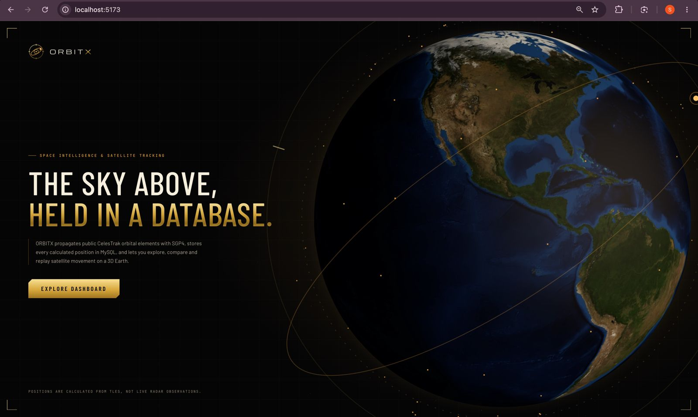
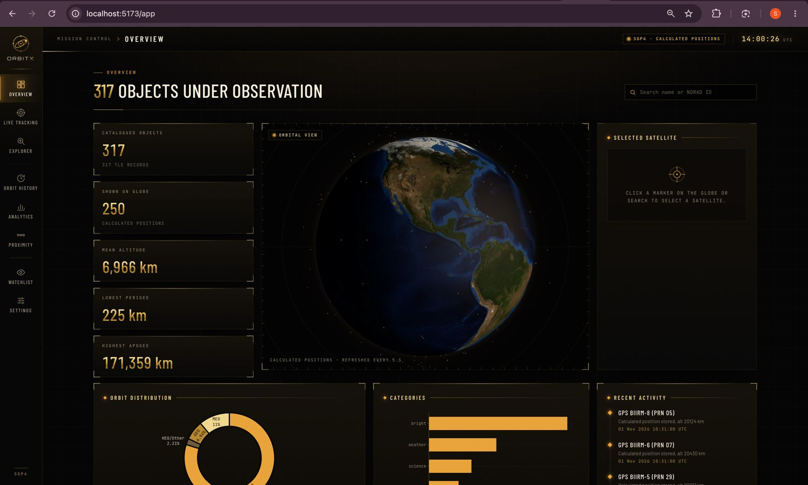
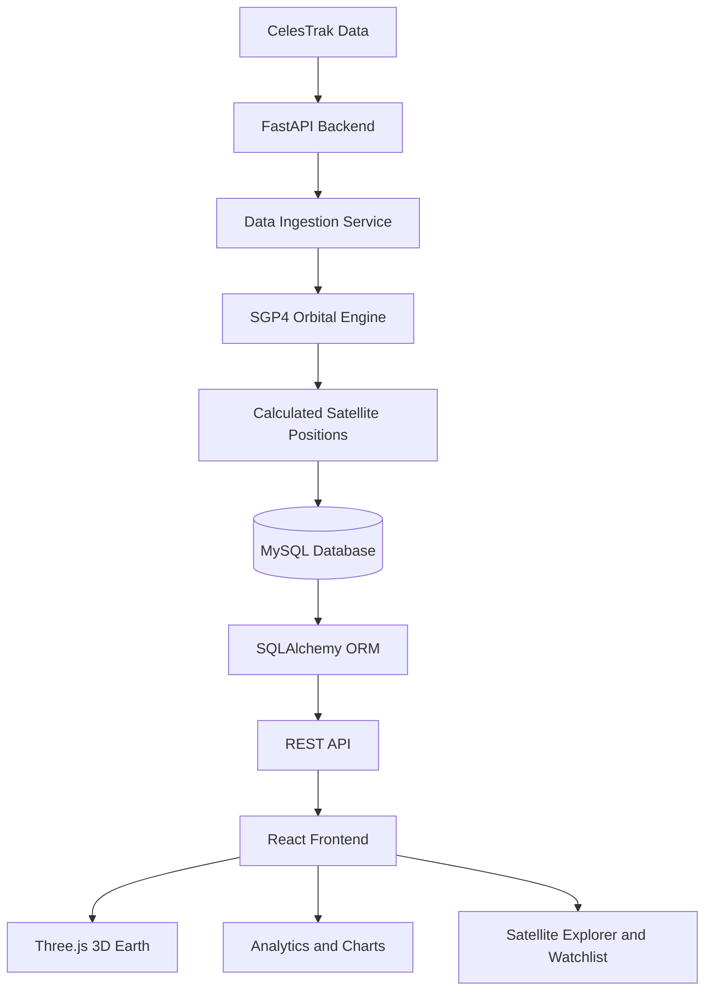

# ORBITX — Space Intelligence & Satellite Tracking Platform

**Interactive 3D satellite tracking and space intelligence platform.** Explore satellites, calculate orbital positions, visualize trajectories, analyze historical movement and monitor estimated close approaches.

```text
CelesTrak  ->  FastAPI  ->  SGP4 Engine  ->  MySQL
                 |
                 v
             React.js  ->  Three.js  ->  3D Earth Visualization
```

     

Built with React.js, Three.js, Python, FastAPI, MySQL and SGP4. Uses publicly available orbital elements from CelesTrak to calculate estimated satellite positions.

**## What it is**

ORBITX is a space intelligence platform that brings satellite tracking and orbital data visualization together in one interface. Users can explore satellites around Earth, inspect their orbital information, view calculated positions, analyze historical records and maintain a personal satellite watchlist.

**## Problem**

Satellite information is spread across different data sources and technical tools. Understanding orbital movement, comparing satellites, viewing historical positions and monitoring close approaches can be difficult without a unified interface.

**## Solution**

ORBITX combines satellite data ingestion, SGP4 orbital calculations, database storage, analytics and interactive 3D visualization into one platform.

CelesTrak provides published orbital elements (TLE/OMM). SGP4 calculates estimated satellite positions from these elements. These calculations are not live radar observations.

**## Screenshots**

**Main Platform**



**Overview**




**Mission Control**


**Estimated Close Approaches**


**Saved Satellites**


**## Architecture**



**## Features**

- Interactive 3D Earth with satellite markers and orbital paths.
- Satellite explorer with search by name and NORAD ID.
- SGP4-based orbital position calculations.
- Satellite latitude, longitude, altitude and velocity information.
- Historical satellite position records.
- Satellite analytics and comparison.
- Estimated close-approach analysis.
- Personal satellite watchlist.
- CelesTrak orbital element synchronization.
- REST API for satellite information and analytics.
- MySQL database for structured satellite and user data.

**## Real workflow**

**Satellite data processing**

```text
CelesTrak publishes orbital elements
-> Backend fetches TLE/OMM data
-> Satellite and orbital records are stored
-> SGP4 calculates satellite positions
-> Position history is saved in MySQL
-> FastAPI exposes data through REST endpoints
-> React frontend fetches the data
-> Three.js visualizes satellites around Earth
```

**## Database Design**

ORBITX uses MySQL to manage satellite information, orbital elements, position history and user watchlists.

**Main tables**

| Table | Purpose |
|---|---|
| users | User information |
| satellites | Satellite records |
| orbital_elements | Orbital element data |
| position_history | Calculated position records |
| watchlists | Saved satellites |
| alerts | Alert records |

**Additional database objects**

- `v_latest_elements` — latest orbital elements view.
- `trg_low_altitude` — low-altitude trigger.
- `sp_upsert_satellite_tle` — satellite TLE upsert procedure.
- `sp_category_stats` — category statistics procedure.

**## ADBMS Concepts**

- Database normalization.
- Primary keys and foreign keys.
- SQL joins and nested queries.
- Aggregate functions.
- Indexing and query optimization.
- Transactions.
- Stored procedures.
- Database views.
- Triggers.

**## API Endpoints**

| Method | Endpoint | Purpose |
|---|---|---|
| GET | `/health` | Backend health |
| GET | `/satellites` | List satellites |
| GET | `/satellites/search?q=` | Search satellites |
| GET | `/satellites/categories` | Satellite categories |
| GET | `/satellites/positions/now` | Current calculated positions |
| GET | `/satellites/{id}` | Satellite details |
| GET | `/satellites/{id}/positions` | Satellite positions |
| GET | `/satellites/{id}/history` | Historical positions |
| POST | `/satellites/{id}/history/record` | Record position history |
| GET | `/analytics` | Satellite analytics |
| GET | `/analytics/compare` | Compare satellites |
| GET | `/proximity` | Estimated close approaches |
| GET/POST | `/watchlist` | View or add watchlist |
| DELETE | `/watchlist/{id}` | Remove watchlist entry |

**## Technology Stack**

| Component | Technology |
|---|---|
| Frontend | React.js, JavaScript |
| 3D Visualization | Three.js |
| Charts | Plotly.js |
| Styling | Tailwind CSS |
| Backend | Python, FastAPI |
| ORM | SQLAlchemy |
| Database | MySQL 8 |
| Orbital Calculations | SGP4 |
| Satellite Data | CelesTrak |
| API Testing | Postman |
| Version Control | Git, GitHub |

**## Installation and Setup**

**Requirements:** Python 3.10+, Node.js, MySQL 8 and Git.

**1. Clone the repository**

```bash
git clone https://github.com/irshadali1786/Space-Intelligence-Satellite-Tracking-Platform.git

cd Space-Intelligence-Satellite-Tracking-Platform
```

**2. Setup database**

```bash
mysql -u root -p < database/schema.sql
```

Note: The schema script recreates the `orbitx` database. Back up existing data before running it.

**3. Setup backend**

```bash
cd backend

python -m venv .venv

source .venv/bin/activate

pip install -r requirements.txt

cp .env.example .env
```

Configure database credentials and other required settings in `.env`.

**4. Ingest satellite data**

```bash
python -m scripts.ingest_celestrak
```

**5. Record satellite positions**

```bash
python -m scripts.record_positions --hours 6 --step 5
```

**6. Start backend**

```bash
uvicorn app.main:app --reload
```

Backend:

`http://localhost:8000`

API documentation:

`http://localhost:8000/docs`

**7. Setup frontend**

Open another terminal:

```bash
cd frontend

npm install

npm run dev
```

Frontend:

`http://localhost:5173`

**## Testing**

- Backend automated tests.
- SGP4 calculation test vectors.
- Database schema and SQL object tests.
- Frontend production build using Vite.

**## Limitations**

- Satellite positions are calculated estimates based on published orbital elements.
- Accuracy depends on the age and quality of orbital data.
- Close-approach analysis is an estimate, not a collision prediction.
- CelesTrak synchronization requires internet access.
- MySQL 8 compatibility should be verified in the target environment.

**## License**

This project is licensed under the MIT License.

**## Academic Project**

**Project:** ORBITX — Space Intelligence & Satellite Tracking Platform

**Project Type:** ADBMS Capstone Project

**University:** Chandigarh University

**GitHub:** [Space Intelligence & Satellite Tracking Platform](https://github.com/irshadali1786/Space-Intelligence-Satellite-Tracking-Platform)
