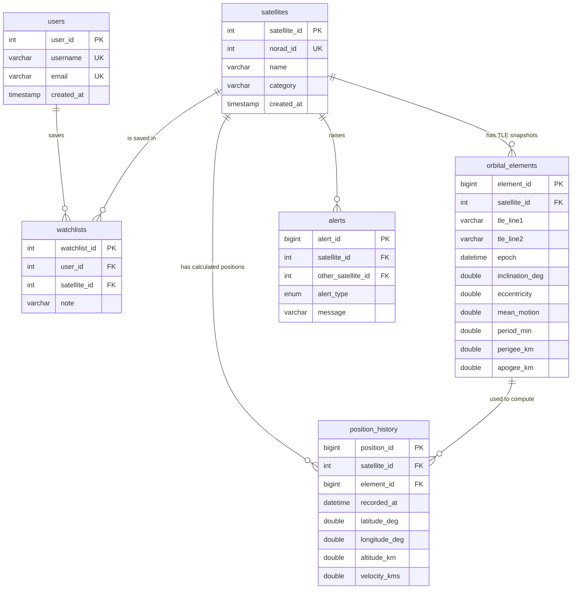

# ORBITX — ER Diagram & Architecture

## ER diagram (Mermaid — renders on GitHub / VS Code Mermaid preview)



**Relationships**
- `users` 1—N `watchlists` N—1 `satellites` → many-to-many resolved by `watchlists`, with `UNIQUE(user_id, satellite_id)`.
- `satellites` 1—N `orbital_elements`: TLEs change every few days, so they are stored separately (3NF — no repeating groups in `satellites`).
- `orbital_elements` 1—N `position_history`: each calculated position records which TLE produced it (traceability).
- `satellites` 1—N `alerts`.

## System architecture

```
CelesTrak (TLE, GP data)
        │  ingest_celestrak.py  (calls sp_upsert_satellite_tle → transaction)
        ▼
   MySQL 8  ◄──── SQLAlchemy ORM ◄──── FastAPI services (SGP4 via `sgp4` lib)
                                              │ REST/JSON
                                              ▼
                       React (Vite) + Tailwind + Three.js + Plotly
```

Positions are **calculated with SGP4 from TLEs**. They are not live radar observations, and the UI labels them that way.
